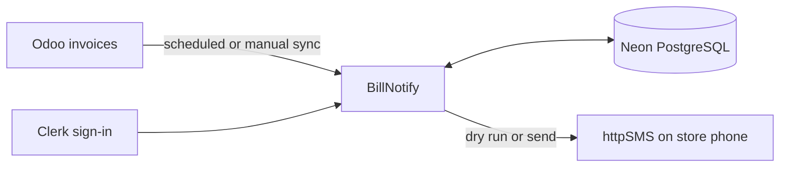

<div align="center">
  
  <h1>BillNotify</h1>
  <p><strong>Invoice reminders for Baba Farid Electrical Store</strong></p>
  <p>Sync posted invoices from Odoo and send customer updates by SMS.</p>
  <p>
    <a href="https://github.com/Baba-Farid-Electrical-Store/Bill-Notify/actions/workflows/ci.yml"></a>
    
    
  </p>
</div>

## What it does

BillNotify is a small, mobile-first operations dashboard for the store. It imports posted customer invoices, prepares invoice links and message templates, and tracks SMS delivery. The app is designed to start in dry-run mode so the first import can be reviewed before any customer is contacted.



## Features

- Invoice dashboard, search, message history, templates, and store settings.
- Odoo JSON-RPC sync with invoice access links where Odoo permits them.
- SMS delivery through httpSMS, with retry tracking and duplicate-send protection.
- Dry-run mode, first-sync review, and a separate confirmation before auto-send.
- Clerk sign-in limited to addresses in `ALLOWED_EMAILS`.
- Installable PWA manifest and offline fallback.

## Safety controls

- The initial sync imports existing invoices as **pre-existing, not notified**; it does not send messages for them.
- Auto-send stays off until an initial sync has completed and a user confirms activation.
- Dry-run is enabled by default. It records intended messages without contacting the SMS provider.
- Manual sends also honor dry-run, and manual sends are rate limited.
- Provider credentials belong in server environment variables. Do not commit `.env.local` or paste credentials into issues, pull requests, or logs.

## Run locally

### Requirements

- Node.js 20 or newer and npm.
- A Neon PostgreSQL database.
- Clerk, Odoo External API, and httpSMS accounts for a connected deployment. You can work on the app without enabling SMS.

### Setup

1. Clone the repository and install packages:

   ```bash
   git clone https://github.com/Baba-Farid-Electrical-Store/Bill-Notify.git
   cd Bill-Notify
   npm ci
   ```

2. Copy `.env.example` to `.env.local` and fill in the values you need. Keep `.env.local` private.
3. Apply the database schema and start the development server:

   ```bash
   npm run db:migrate
   npm run dev
   ```

4. Open [http://localhost:3000](http://localhost:3000), sign in with an allowed email, and run the first sync.
5. Review imported invoices while dry-run is on. Test both provider connections before enabling real sends.

## Environment variables

| Variable | Required | Purpose |
| --- | --- | --- |
| `DATABASE_URL` | Yes | Neon PostgreSQL connection string. |
| `NEXT_PUBLIC_CLERK_PUBLISHABLE_KEY` | Yes for sign-in | Clerk publishable key. |
| `CLERK_SECRET_KEY` | Yes for sign-in | Clerk server secret. |
| `ALLOWED_EMAILS` | Yes for sign-in | Comma-separated sign-in allow-list. |
| `ODOO_URL` | For sync | Odoo base URL. |
| `ODOO_DB` | For sync | Odoo database name. |
| `ODOO_USERNAME` | For sync | Odoo API user. |
| `ODOO_API_KEY` | For sync | Odoo external API key. |
| `HTTPSMS_API_KEY` | For SMS | httpSMS API key. |
| `HTTPSMS_FROM_NUMBER` | For SMS | Sender number configured on the store phone. |
| `CRON_SECRET` | For scheduled sync | Secret expected as `Authorization: Bearer …`. |
| `STORE_NAME` | No | Store name used when initializing settings. |
| `LOOKBACK_HOURS` | No | Initial invoice lookback window; defaults to 24. |

## Deploy

The app can be deployed to Vercel. Add the required environment variables in the Vercel project settings, then apply the database migration. `vercel.json` schedules a daily sync. For more frequent syncs, configure an external scheduler to call `https://YOUR_DOMAIN/api/cron/sync` every 5–15 minutes with `Authorization: Bearer YOUR_CRON_SECRET`.

The cron route requires `CRON_SECRET`; it does not accept the Vercel cron header by itself. Keep dry-run enabled until invoice imports and both provider connections have been reviewed.

On the store phone, install the httpSMS Android app, sign in to the matching account, enable the phone as a sender, and keep it online with SMS permission. Use the sender number configured by httpSMS.

## Project commands

| Command | Purpose |
| --- | --- |
| `npm run dev` | Start local development. |
| `npm run build` | Create a production build. |
| `npm run start` | Serve a production build. |
| `npm run lint` | Run the Next.js ESLint checks. |
| `npm run typecheck` | Check TypeScript types. |
| `npm test` | Run the unit test suite. |
| `npm run db:generate` | Generate a Drizzle migration. |
| `npm run db:migrate` | Apply database migrations. |

## Contributing

Small, focused pull requests are easiest to review. Please read [CONTRIBUTING.md](CONTRIBUTING.md), avoid including real customer data or credentials, and describe any operational or database changes in the pull request.

## Security

Please do not report security issues in public. See [SECURITY.md](SECURITY.md) for the private reporting route and the information to include.

## License

No license has been specified yet. Ask the repository owner before reusing or redistributing this code.
